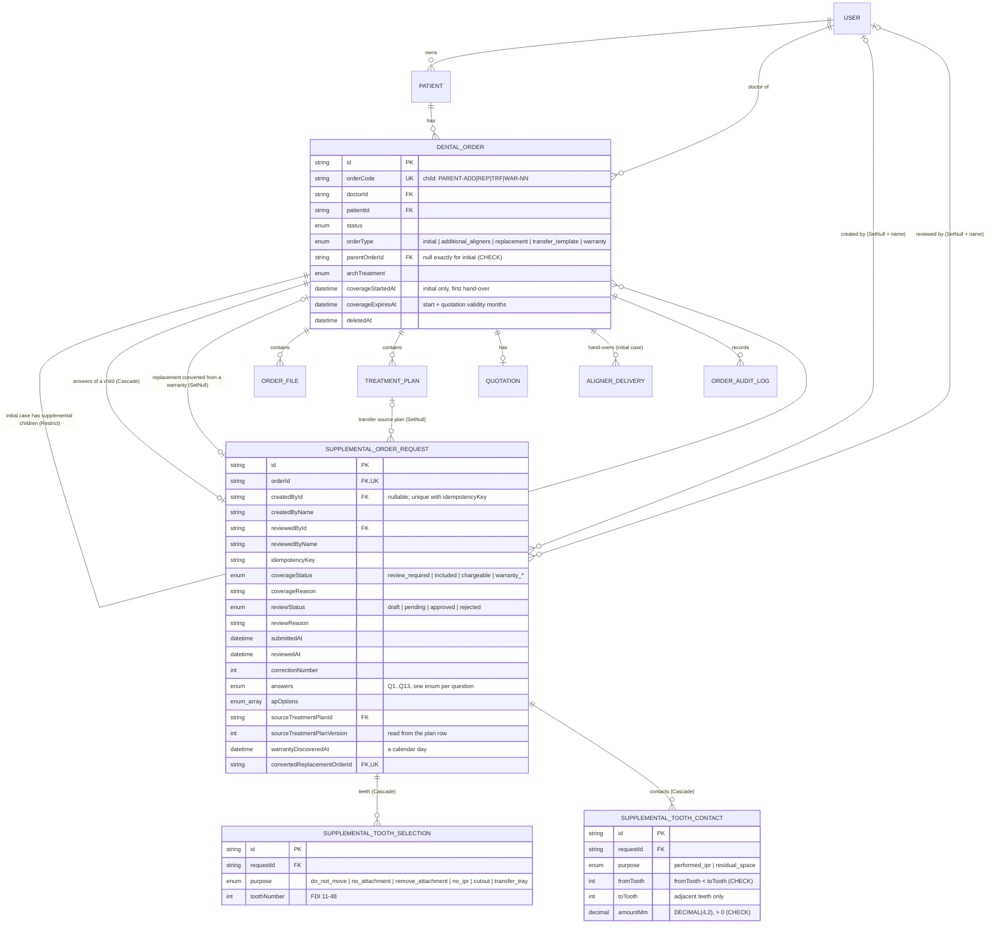
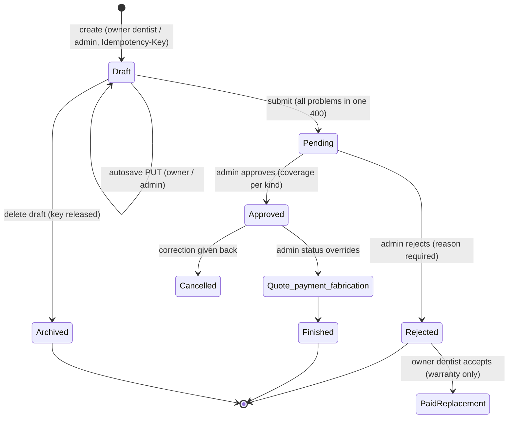

# Supplemental orders data model (v2)

A supplemental request (additional aligners, replacement, transfer template,
warranty claim) is a child `DentalOrder` of an initial case plus one
`SupplementalOrderRequest` row holding its typed answers. The teeth and
contacts the doctor prescribes live in two request-owned tables.

Migrations: `20261110000000_supplemental_orders` (v1, applied) and
`20261112000000_supplemental_aligner_form` (v2: one enum per question,
request-owned teeth/contacts, actor snapshots, source-plan FK, data
conversion of the v1 rows).
Code: `oralign-backend/src/orders/supplemental/` (pure rules + services),
`controllers/supplemental-order.controller.ts`, `dto/supplemental-order.dto.ts`.

## Entity relationship diagram

Unique keys: `SupplementalToothSelection (requestId, purpose, toothNumber)`,
`SupplementalToothContact (requestId, purpose, fromTooth, toTooth)`,
`SupplementalOrderRequest (createdById, idempotencyKey)`, `(orderId)`,
`(convertedReplacementOrderId)`. SQL-only CHECKs (Prisma cannot express them):
`DentalOrder_order_type_parent_check`, `SupplementalToothContact_pair_check`.

The doctor's prescription is NOT stored in `OrderToothInstruction` any more:
that table's `attachment` type belongs to the planner's plan editor, which
rewrites it. `ToothInstructionType.precision_cut` stays in the enum, reserved
and unused (Postgres cannot drop an enum value cheaply).

## The additional-aligner form

| # | question | column(s) | details it can ask for |
|---|---|---|---|
| 1 | reason | `reason`, `reasonDetails` (other) | |
| 2 | current aligner per treated arch | `currentUpperAligner`, `currentLowerAligner` | |
| 3 | arches, opposite arch for one arch | `DentalOrder.archTreatment`, `passiveOppositeArch` | |
| 4 | new scan per arch | `newUpperScan`, `newLowerScan` | |
| 5 | clinical objective | `clinicalObjective` | |
| 6 | teeth not to move | `movementRestriction` | `selected_teeth` → teeth `do_not_move` |
| 7 | A-P correction per side, options | `apRelationshipRight/Left`, `apOptions`, `elasticCutouts` | |
| 8 | new attachments | `attachmentPolicy` | `avoid_selected_teeth` → teeth `no_attachment` |
| 9 | existing attachments | `existingAttachmentPolicy` | `remove_selected` → teeth `remove_attachment` |
| 10a | IPR in the new series | `iprPolicy` | `avoid_selected_teeth` → teeth `no_ipr` |
| 10b | IPR already performed | `previousIpr` | `different` → contacts `performed_ipr` (0.05-2.00 mm) |
| 11 | cut-outs | `precisionCutPolicy` | `selected_teeth` → teeth `cutout` |
| 12 | residual spaces | `residualSpacePolicy` | `close_specified` → contacts `residual_space` (0.05-9.99 mm) |
| 13 | instructions per arch | `upperInstructions`, `lowerInstructions` | |
| scans | impression method | `impressionMethod` | intraoral → scan files on the child |

The option → detail table is `SUPPLEMENTAL_DETAIL_OWNERS`
(`supplemental.constants.ts`). Every draft save drops the details whose owning
option is not selected; at submission a selected option with no detail is a
problem. A transfer template always asks for `transfer_tray` teeth.

## Lifecycle

`DentalOrder.status` and `reviewStatus` are one workflow stored twice; every
writer of the child's status applies `reviewStatePatch` (review-state.ts) in
the same transaction.

| order status | reviewStatus |
|---|---|
| draft | draft (submission and review fields cleared) |
| submitted | pending (review fields and correction number cleared) |
| under_review (approval) | approved |
| rejected | rejected |
| any later status | unchanged |

## Rules

- The initial case is never mutated by a request. A child copies the case's
  doctor, patient and designer.
- One open request per kind per case: open = status not in
  `finished, canceled, cancelled, rejected` and not archived (a draft is
  open). Checked under the parent row lock (`SELECT … FOR UPDATE`).
- Child code: `${parentCode}-${ADD|REP|TRF|WAR}-${NN}`, NN = 1 + the highest
  numeric suffix among the existing codes of that stem, computed under the
  parent lock (never a count: rows can be purged).
- Eligibility: an initial, live case, not draft / cancelled / rejected, with
  an approved plan. `blockedReason` (approved_plan_required,
  parent_not_eligible, active_request_exists) is separate from
  `coverageReason`. Submission re-checks it with the request itself excluded.
- Coverage (server side, `supplemental-coverage.policy.ts`): additional
  aligners use the paid pack snapshot (`Quotation.includedCorrections`,
  `isUnlimitedCorrections`, `treatmentValidityMonths`) and the coverage
  window; unknown is never free (review_required). Replacement and transfer
  template are chargeable; a warranty claim goes to review.
- Consumed corrections = approved, included additional-aligner children not
  archived and not cancelled / rejected (`countConsumedCorrections`, the one
  count used by eligibility, submission and review). A correction is consumed
  only at approval, numbered then (`correctionNumber`), and given back when
  the child is later cancelled or rejected.
- Review coverage per kind: additional aligners included | chargeable
  (included re-checks the allowance: 409 when used up); replacement and
  transfer template chargeable; warranty approve = warranty_approved, reject =
  warranty_rejected. Anything else is a 400.
- A rejected warranty becomes a paid replacement only with the owning
  dentist's consent: one transaction creates the replacement (same arch,
  aligner N → N, quantity 1, chargeable
  `warranty_rejected_doctor_confirmed`), links it and audits the warranty,
  the replacement and the case. A live link is returned as is; an archived
  one is replaced and relinked.
- Permissions (`supplemental-permissions.ts`): create / edit / submit /
  delete draft = owning dentist or admin; review = admin; convert = owning
  dentist; read = OrderAccessPolicy (designers: assigned cases), and the list
  of a case's requests is scoped the same way. Every view carries
  `permissions`, the eligibility carries `canCreate`.
- Audit: each event writes the child's row (with its field diff) and a
  `supplemental_child_*` row on the case (metadata only). A draft save that
  changes nothing writes no row.
- Review is possible only while the child's order status is `submitted` AND
  its reviewStatus is `pending` (`isAwaitingReview`, used by the guard and by
  `permissions.canReview`). An admin cancel leaves reviewStatus as it was:
  there is no "cancelled" review state, and `rejected` means a decision with
  a reason.
- Correction numbers: the allowance is checked on the COUNT of live consumed
  corrections; the number given is 1 + the highest number still live, so two
  live requests never share a number. An admin override that brings back a
  given-back included correction (e.g. cancelled → finished) re-checks the
  allowance under the case lock (409 `SUPPLEMENTAL_ALLOWANCE_EXHAUSTED`) and
  renumbers it if its old number is taken (`supplemental-override.ts`).
- Teeth and contacts must sit on a treated arch (upper 11–28, lower 31–48):
  every draft save drops the others, submission reports any left. No arch
  chosen = no details.
- Photos and scans are checked by upload slot, the same way as the wizard:
  the five intraoral views are the slots `right-lateral`, `frontal-occlusion`,
  `left-lateral`, `upper-occlusal`, `lower-occlusal` (file names prefixed
  `<slot>__`; unprefixed files count only for the unambiguous categories
  right/upper/lower photo); arch scans are stl/ply/obj/zip files except the
  bite-registration slots `first-occlusion` and `second-occlusion`.
- Instructions (Q13) are required when the reason is a treatment-plan change,
  the plan configuration is "other", or an A-P side is "improve canine and
  molar".
- Idempotency keys starting with the server prefixes `archived_` and
  `warranty-` are refused from clients.
